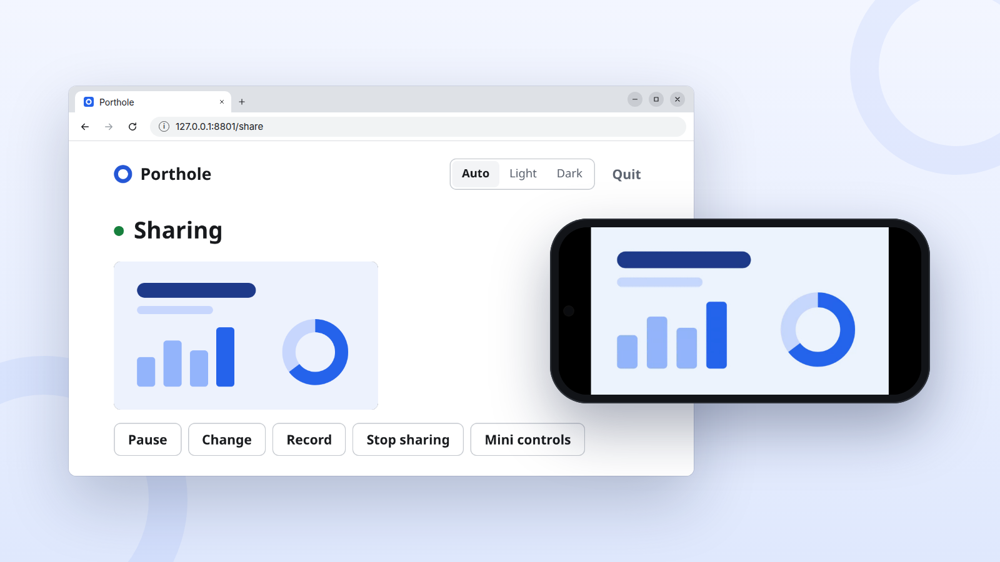
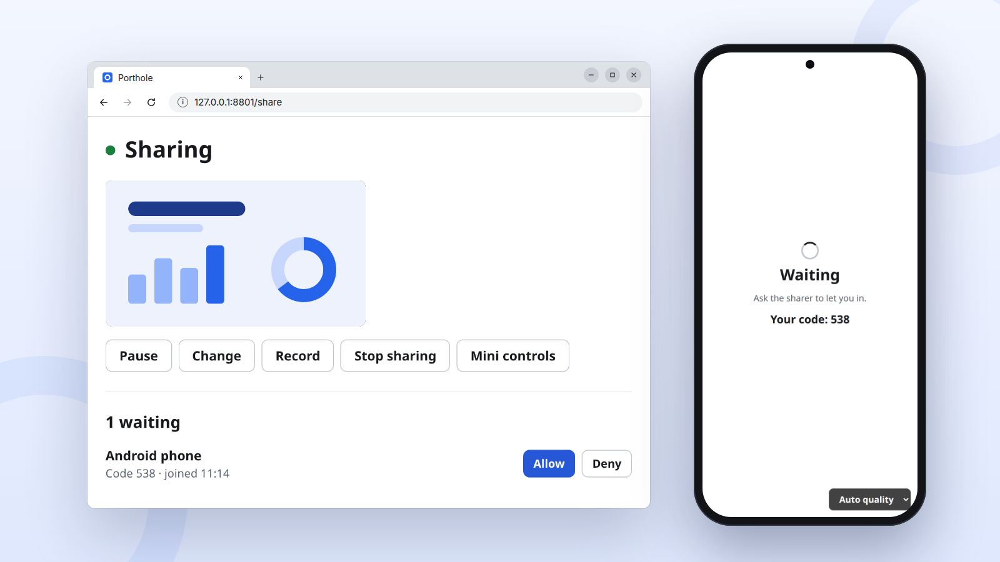

<div align="center">


# Porthole

**Share your screen with phones and PCs on your Wi-Fi. They just open a link.**<br>
Viewers install nothing. No account and no internet needed.

[](https://github.com/bahrambakhtiyar/Porthole/actions/workflows/linux.yml)
[](LICENSE)
[](https://github.com/bahrambakhtiyar/Porthole/releases/latest)
[](https://snapcraft.io/porthole)
[](https://kreosus.com/bahram_bakhtiyar?utm_source=kreosus_embed&utm_medium=badge&utm_campaign=bahram_bakhtiyar)

[Install](#install) · [How it works](#how-it-works) · [FAQ](#faq) · [Support](#support)

<picture>
  <source media="(prefers-color-scheme: dark)" srcset="docs/screenshots/hero-dark.png">
  
</picture>

</div>

## Why Porthole

- **Nothing to install on phones.** Viewers scan a QR code or open a link in the browser they already have.
- **Works without internet.** The picture goes straight from your PC to each screen over your own Wi-Fi.
- **Your picture stays on your network.** Porthole makes no internet connections of its own.
- **You decide who watches.** With **Ask before someone watches** (on by default), each new device waits until you press **Allow**.
- **Record, pause, and an easy address.** Save what you share as a video, pause for a moment, and let people type `porthole.local:8765` instead of the link.
- **Free and open source,** under the AGPL-3.0.

## Install

Porthole is ready for Linux. On Windows and macOS it runs from source for now; installers come later. Downloads are on the [Releases page](https://github.com/bahrambakhtiyar/Porthole/releases).

**Snap** (Ubuntu and most Linux, on 64-bit Intel or AMD PCs): search for **Porthole** in Ubuntu's App Center, or run

```bash
sudo snap install porthole
```

[](https://snapcraft.io/porthole)

It updates by itself, and opens Porthole in your default browser, not in its own window.

**.deb** (Ubuntu, Debian, Mint): download the `.deb` file from Releases, then in the folder you saved it to

```bash
sudo apt install ./porthole_*_all.deb
```

**AppImage** (any Linux on 64-bit Intel or AMD PCs; nothing to install, it brings its own Python): download `Porthole-x86_64.AppImage` from Releases, then

```bash
chmod +x Porthole-x86_64.AppImage
./Porthole-x86_64.AppImage
```

To put it in your app menu, run it once with `--install-launcher` and keep the file where it is.

On an ARM PC, such as a Raspberry Pi, use the .deb or run from source.

**From source** (Windows and macOS until their installers are ready, or any PC): install [Python](https://www.python.org/downloads/) 3.10 or newer, download Porthole (**Code > Download ZIP**), unzip it, and in that folder run

```bash
py start.py        # Windows
python3 start.py   # macOS and Linux
```

When Windows Firewall asks about Python, allow it on both **Private** and **Public** networks. On a Mac, allow screen recording when macOS asks, then quit the app it named (your browser or Terminal) and start Porthole again. More for each system in [Install in detail](docs/design.md#install-in-detail), and every option in [Command-line options](docs/design.md#command-line-options).

## Share your screen in 3 steps

1. **Open Porthole** from your app menu (or run `porthole`, the AppImage, or `python3 start.py`). The sharer page opens in its own window, or in your browser.
2. **Press Start sharing** and pick a screen or a window.
3. **Viewers scan the QR code or open the link** on their phone or PC. With **Ask before someone watches** on, each one waits with a 3-digit code: press **Allow** next to the matching code.

<div align="center">
<picture>
  <source media="(prefers-color-scheme: dark)" srcset="docs/screenshots/allow-dark.png">
  
</picture>
</div>

To stop, press **Quit** on the page. Closing Porthole's own window also stops it, but closing a browser tab doesn't. Each run makes a new link.

## Good to know

- **Use it on networks you trust**, such as your home, office or classroom Wi-Fi. The picture and sound are encrypted, but the pages use plain HTTP on your own network. Ask before someone watches lets you turn away people who only know the address, but not someone who can read the network traffic. See [SECURITY.md](SECURITY.md).
- **Viewers see everything you share,** notifications included. Turn on Do not disturb, or share one window.
- **Sound:** Chrome and Edge share a tab's sound (pick the tab and turn on "Also share tab audio"), and on Windows the whole computer's sound. Firefox and Safari share no sound. Porthole's own window can't see your browser's tabs: to share a tab or its sound, press **Open in my browser** first.
- **Recording:** **Record** saves what you share in `Videos/Screen shares` (`Movies/Screen shares` on a Mac).
- **On a phone,** tap the picture for the buttons (sound, 1:1, quality, full screen, save a picture) and pinch to zoom.

Every switch, message and option: [Using Porthole in detail](docs/design.md#using-porthole-in-detail).

## How it works

Porthole is a small web server written with Python's standard library only. It serves two pages, one for you and one for viewers, and passes the short set-up messages between your browser and theirs. The picture goes straight from browser to browser over WebRTC, never through the server. More in [docs/design.md](docs/design.md).

## How Porthole is made

Porthole is built by Bahram Bakhtiyar with a lot of help from Claude, Anthropic's AI, which wrote most of the code and the docs. Bahram decides what Porthole does and how it looks, says yes or no to every change people can see, and tests it on his own Ubuntu PC with an iPhone and an Android phone.

Every change is checked before it lands: over a thousand automated tests run on each pull request (the Python server, the page code, and the real pages in headless Chrome), and each build of main also builds and starts every package. The checks that need real devices are in [docs/manual-tests.md](docs/manual-tests.md), and the reasons behind each design decision are in [docs/design.md](docs/design.md).

## Troubleshooting

<details>
<summary><b>Viewers can't connect</b></summary>

- The phone must be on the **same Wi-Fi** as the PC: not mobile data, not a guest network.
- **Quick check:** on the phone, open `http://<the PC's address>:8765/` (the address and port are in the link on the sharer page). Any Porthole page, even "Nothing here", means the phone can reach the PC.
- **Firewall on Ubuntu:** run `sudo ufw allow 8765/tcp` once (the terminal names the port if Porthole uses another one). **On Windows:** allow Python on both Private and Public networks.
- **A VPN** can block local connections; pause it while sharing.
- **Still stuck?** Start Porthole with `--verbose` and watch the terminal: if the phone's requests never show up, the network or a firewall is blocking it.

More cases in [If viewers can't connect](docs/design.md#if-viewers-cant-connect).

</details>

<details>
<summary><b>Guest or office Wi-Fi keeps devices apart</b></summary>

Some networks stop devices from seeing each other. Connect the PC and the viewers to a phone's hotspot instead: the video stays between the devices and uses no mobile data.

</details>

<details>
<summary><b>porthole.local doesn't open</b></summary>

- Turn on **Easy address** on the sharer page. Before you start sharing, the address shows a waiting page that opens the share once you start.
- When Porthole runs on Linux, type `porthole.local:8765`; on Windows or a Mac, plain `porthole.local` works too. The sharer page shows the address to type.
- Some Android phones can't open `.local` names: scan the QR code instead.
- On an iPhone, iPad or Mac, a browser other than Safari needs **Local Network** allowed in Settings (Privacy & Security).

</details>

<details>
<summary><b>"This link doesn't work" or "Porthole was restarted"</b></summary>

The link is from an earlier run of Porthole (each run makes a new link) or has a typo. Open the link shown on the sharing PC, or scan its QR code.

</details>

## FAQ

<details>
<summary><b>Which browsers work?</b></summary>

To watch: Chrome on Android, Safari on iPhone and iPad, and any modern browser on a PC. To share: a desktop browser on the PC that runs Porthole. Chrome and Edge do the most (tab sound, mini controls); Firefox and Safari share the picture without sound.

</details>

<details>
<summary><b>Does it need the internet?</b></summary>

No. Everything stays on your local network, so it works on a Wi-Fi with no internet at all, or on a phone's hotspot.

</details>

<details>
<summary><b>Can viewers control my PC? Can I share from my phone?</b></summary>

No to both. Viewers can only watch, and phone browsers don't allow screen capture.

</details>

<details>
<summary><b>How many people can watch?</b></summary>

A handful: each viewer gets its own stream from your PC, which suits a room, not dozens of people.

</details>

<details>
<summary><b>Is it free?</b></summary>

Yes. Porthole is free and open source under the GNU AGPL-3.0. If it helps you, see [Support](#support).

</details>

## Contributing

Bug reports and pull requests are welcome. Questions, ideas and what you use Porthole for go in [Discussions](https://github.com/bahrambakhtiyar/Porthole/discussions). Please read [CONTRIBUTING.md](CONTRIBUTING.md) first: the server uses Python's standard library only, the pages are plain HTML, CSS and JavaScript, and every change comes with tests. Your first pull request asks you to agree to the [contributor licence agreement](CLA.md) once. The checks that need real phones are in [docs/manual-tests.md](docs/manual-tests.md). Report security problems privately, as [SECURITY.md](SECURITY.md) explains.

## Support

If Porthole is useful to you, you can support its development on [Kreosus](https://kreosus.com/bahram_bakhtiyar). A star on GitHub helps other people find it.

## Licence

Porthole is free software under the GNU Affero General Public License, version 3 only (AGPL-3.0-only): see [LICENSE](LICENSE). Every package carries a copy. The AppImage also carries `THIRD-PARTY-NOTICES.txt` for the Python, libraries and AppImage runtime it brings. Contributions need the contributor licence agreement in [CLA.md](CLA.md); see [CONTRIBUTING.md](CONTRIBUTING.md). Copyright 2026 Bahram Bakhtiyar.
